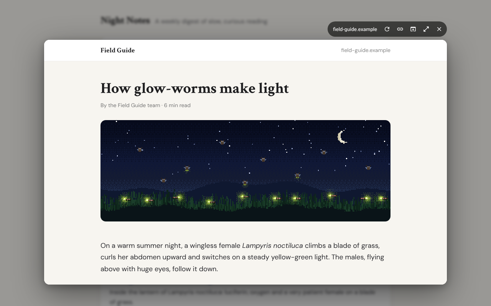
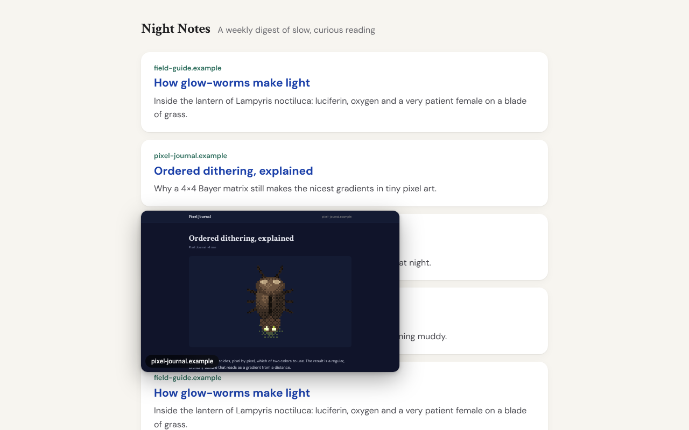

<p align="center">
  
</p>
<h1 align="center">Lampyris</h1>
<p align="center">
  <a href="README.pt-BR.md">Português</a> · English
</p>

**Arc-style Peek for any browser.** Alt+click a link and it opens in a floating window over the page. Look, close, and you're right where you were. If it's worth keeping, promote it to a real tab with one click.

<p align="center">
  
</p>
<p align="center"><sub>True to the species: in <i>Lampyris noctiluca</i> the wingless females glow on the grass at night, and the males fly in search of them with only a pair of tiny, faint lights.</sub></p>

## Features

- **Alt+click any link** to peek it (or Shift+click, your choice). On a Mac, Alt is ⌥ Option.
- **Mini Peek:** hold Shift and rest the pointer on a link for a small live preview next to it. Click it to open the full Peek. The key is configurable (Shift, Alt or Ctrl/⌘) or it can be turned off. The preview loads without your login, so a glance can never act on your account.
- **Pinned tabs work like Arc:** links to *other sites* open in a Peek automatically, links within the same site navigate normally.
- **Right-click a link → Peek with Lampyris.**
- **Close** with Esc, the ✕ button, or a click outside.
- **Toolbar** above the Peek: current site, reload, copy link, open in a window, open as a tab.
- **Navigation stays inside the Peek** and never touches the page's history.
- **You stay logged in.** Sites open inside the Peek with your normal login, just like in a tab (see *How the login works* below).
- **Sites that refuse to be framed** still open: while a Peek is open, Lampyris lifts the anti-framing headers for that tab only. If a page still can't load, it falls back to a small popup window automatically.
- Three sizes, a per-site off switch, English and Brazilian Portuguese.

## See it in action

**Peek** — Alt+click a link: the page opens over the one you're reading, with the toolbar on top.

<p align="center"></p>

**Mini Peek** — hold Shift and rest the pointer on a link: a small live preview appears next to it. Click it to open the full Peek.

<p align="center"></p>

## Install

Lampyris works on **Chromium browsers** (Chrome, Edge, Brave, Opera, Vivaldi…) and **Firefox 140+** from the same code.

**Stores:** Chrome Web Store *coming soon* · Firefox Add-ons *coming soon*

**Manually on Chromium:**

1. Download `lampyris-<version>-chrome.zip` from the [latest release](https://github.com/GGuilhermeAlves/lampyris/releases/latest) and extract it to a folder you won't delete.
2. Open `chrome://extensions` (or `edge://extensions`, `brave://extensions`…).
3. Turn on **Developer mode**.
4. Click **Load unpacked** and select the extracted folder (or `extension/` from a clone).
5. Reload any tabs that were already open.

**Manually on Firefox (temporary, for testing):**

1. Open `about:debugging#/runtime/this-firefox`.
2. Click **Load Temporary Add-on…** and pick `extension/manifest.json`.
3. Open `about:addons` → Lampyris → **Permissions** and allow access to all websites, otherwise links won't be intercepted.

## Limitations

A browser extension can't do everything Arc does from inside the browser itself:

- **Ctrl/Cmd+W** can't be captured by extensions. Use Esc.
- Links opened by scripts (`window.open`) aren't intercepted, only real links.
- Browser pages (`chrome://`, the extension stores) don't allow extensions to run.

## How the login works

A site embedded in another page normally loses your login: the browser withholds its cookies and gives it separate, empty storage, to protect you from pages that would hide your bank inside them. Lampyris works around this safely:

1. The site is embedded through a page of the extension itself. Chrome treats a site embedded by an extension that has permission for it like a site opened in a tab: same storage, cookies sent on the first load.
2. Requests the site makes afterwards (data, images, links clicked inside the Peek) get the site's own cookies through a rule that applies **only in that tab, only to the peeked site, only when that site makes the request, and only while the Peek is open**.
3. The extension page only loads a link in exchange for a one-time ticket created when you click, bound to that tab, and its address changes every session. Other sites can't use it to embed a logged-in page.

This was tested in Chrome. Firefox handles extension frames differently and hasn't been tested yet; if a site appears logged out there, use **Open in a window**.

## Why "Lampyris"?

*Lampyris noctiluca* is the common glow-worm of Europe. *Lampyris* is Greek for "firefly", from *lámpein*, "to shine"; *noctiluca* is Latin for "she who shines at night". Like a firefly's brief glow in the dark, the Peek lights up a window for a moment and is gone. The icon is the male, drawn true to the species: brown, a shield covering the head with two pale windows, and the pair of tiny lights at the tip of the abdomen.

## Development

```
extension/
├── manifest.json          universal MV3 manifest (Chromium + Firefox)
├── content.js             click handling and the Peek window
├── frame.html / frame.js  the extension frame that keeps you logged in
├── background.js          framing and login rules, Peek tracking, popup-window fallback, context menu
├── popup.html/.css/.js    settings
├── _locales/              en, pt_BR
└── icons/
scripts/pack.sh            builds dist/lampyris-<version>-chrome.zip and -firefox.zip
```

There is no build step. Edit files in `extension/`, then click ↻ on the extension card in `chrome://extensions` (or **Reload** in Firefox's `about:debugging`) and reload the page.

```
./scripts/pack.sh        # → dist/lampyris-1.0.0-chrome.zip + dist/lampyris-1.0.0-firefox.zip
```

## Privacy

Lampyris collects nothing and sends nothing anywhere. See [PRIVACY.md](PRIVACY.md).

## License

[MIT](LICENSE)
