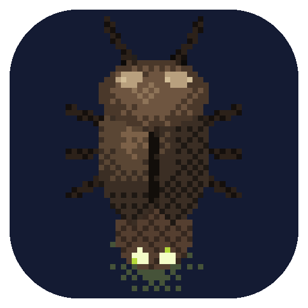
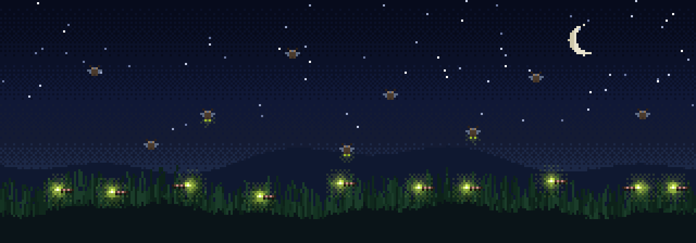
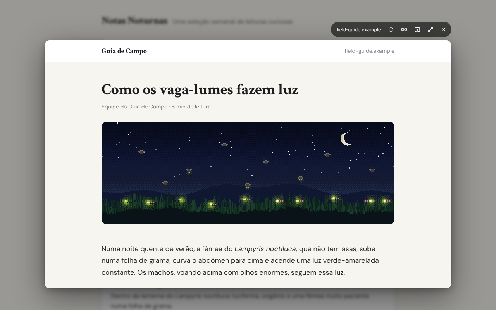
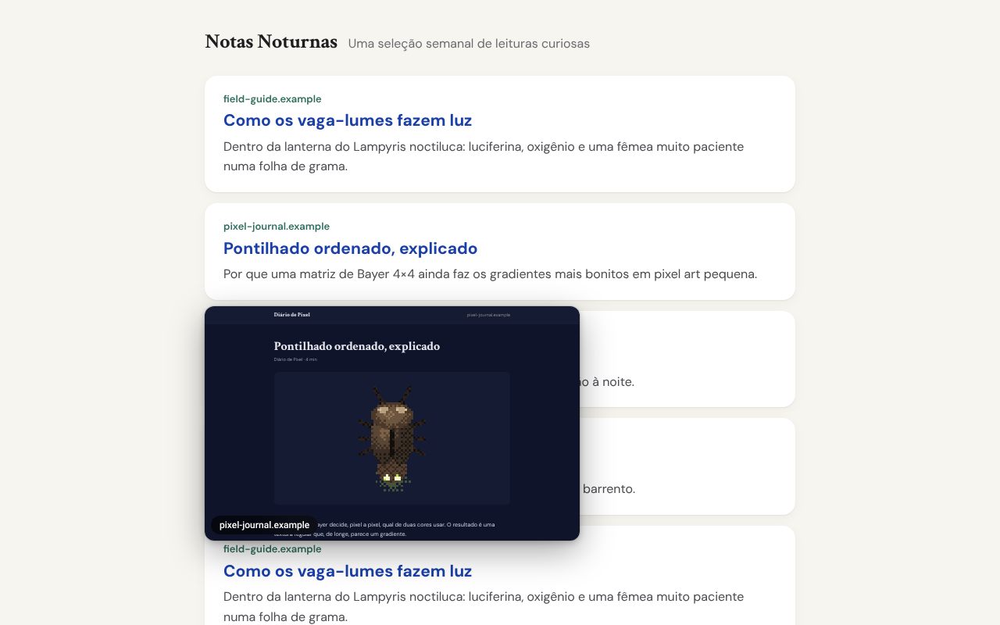

  

<h1 align="center">Lampyris</h1>

  
  
  
  

  <a href="README.md">English</a> · <b>Português (Brasil)</b>

**O Peek do Arc em qualquer navegador.** Dê Alt+clique num link e ele abre numa janela flutuante por cima da página. Dê uma olhada, feche e você continua exatamente onde estava. Se valer a pena, transforme em aba de verdade com um clique.

  

Fiel à espécie: no <i>Lampyris noctiluca</i>, as fêmeas, que não têm asas, brilham na grama à noite, e os machos voam à procura delas só com duas luzinhas fracas.

## Funções

- **Alt+clique em qualquer link** para espiar (ou Shift+clique, você escolhe). No Mac, o Alt é o ⌥ Option.
- **Peek automático (opcional):** coloque o Peek em **Auto** e um clique normal em qualquer link para outro site abre no Peek, em todas as abas.
- **Mini Peek:** segure Shift e pare o mouse em cima de um link para ver uma prévia ao vivo ao lado dele. Clique nela para abrir o Peek completo. A tecla é configurável (Shift, Alt ou Ctrl/⌘) ou **Auto**, que dispensa tecla: basta parar o mouse um instante no link. A função também pode ser desligada. A prévia abre sem o seu login, então uma espiada nunca executa nada na sua conta.
- **Abas fixadas funcionam como no Arc:** links para *outros sites* abrem no Peek automaticamente, e links do mesmo site navegam normalmente.
- **Botão direito num link → Espiar com o Lampyris.**
- **Fechar** com Esc, com o botão ✕ ou clicando fora.
- **Barra de ações** em cima do Peek: site atual, recarregar, copiar link, abrir numa janela e abrir como aba.
- **A navegação fica dentro do Peek** e não mexe no histórico da página.
- **Você continua logado.** Os sites abrem dentro do Peek com o seu login normal, como numa aba (veja *Como o login funciona* abaixo).
- **Sites que recusam ser abertos dentro de outra página** abrem mesmo assim: enquanto um Peek está aberto, o Lampyris remove os cabeçalhos que bloqueiam isso, só naquela aba. Se mesmo assim a página não carregar, ela abre automaticamente numa janelinha pop-up.
- Três tamanhos, opção para desligar por site, inglês e português.

## Veja funcionando

**Peek**: dê Alt+clique num link e a página abre por cima da que você está lendo, com a barra de ações em cima.

**Mini Peek**: segure Shift e pare o mouse em cima de um link para ver uma prévia ao vivo ao lado dele. Clique nela para abrir o Peek completo.

## Instalação

O Lampyris funciona em **navegadores Chromium** (Chrome, Edge, Brave, Opera, Vivaldi…) e no **Firefox 140+**, com o mesmo código.

**Lojas:** Chrome Web Store *em breve* · Firefox Add-ons *em breve*

**Manual no Chromium:**

1. Baixe o `lampyris-<versão>-chrome.zip` da [última versão](https://github.com/GGuilhermeAlves/lampyris/releases/latest) e extraia numa pasta que você não vá apagar.
2. Abra `chrome://extensions` (ou `edge://extensions`, `brave://extensions`…).
3. Ative o **Modo do desenvolvedor**.
4. Clique em **Carregar sem compactação** e selecione a pasta extraída (ou a pasta `extension/`, se você clonou o repositório).
5. Recarregue as abas que já estavam abertas.

**Manual no Firefox (temporário, para testar):**

1. Abra `about:debugging#/runtime/this-firefox`.
2. Clique em **Carregar extensão temporária…** e escolha o `lampyris-<versão>-firefox.zip` da [última versão](https://github.com/GGuilhermeAlves/lampyris/releases/latest) (num clone, rode `./scripts/pack.sh` antes e escolha o zip em `dist/`).
3. Abra `about:addons` → Lampyris → **Permissões** e permita o acesso a todos os sites. Sem isso os links não são interceptados.

## Limitações

Uma extensão não consegue fazer tudo o que o Arc faz por ser o próprio navegador:

- **Ctrl/Cmd+W** não pode ser capturado por extensões. Use Esc.
- Links abertos por scripts (`window.open`) não são interceptados, só links de verdade.
- Páginas do navegador (`chrome://`, as lojas de extensões) não permitem extensões.

## Como o login funciona

Um site embutido em outra página normalmente perde o seu login: o navegador não envia os cookies dele e lhe dá um armazenamento separado e vazio, para proteger você de páginas que escondessem o seu banco dentro delas. O Lampyris contorna isso com segurança:

1. O site é embutido por uma página da própria extensão. O Chrome trata um site embutido por uma extensão que tem permissão para ele como um site aberto numa aba: mesmo armazenamento e cookies enviados no primeiro carregamento.
2. As requisições que o site faz depois (dados, imagens, links clicados dentro do Peek) recebem os cookies do próprio site por uma regra que vale **só naquela aba, só para o site espiado, só quando é esse site que faz a requisição e só enquanto o Peek está aberto**.
3. A página da extensão só carrega um link em troca de um código de uso único, criado no clique e preso àquela aba, e o endereço dela muda a cada sessão. Outros sites não conseguem usá-la para embutir uma página logada.

Isso foi testado no Chrome. O Firefox trata os quadros de extensões de outro jeito e ainda não foi testado; se um site aparecer deslogado lá, use **Abrir numa janela**.

## Por que "Lampyris"?

*Lampyris noctiluca* é o vaga-lume mais comum da Europa. *Lampyris* é "vaga-lume" em grego, de *lámpein*, "brilhar"; *noctiluca* é latim para "a que brilha de noite". Como a luz rápida de um vaga-lume no escuro, o Peek acende uma janela por um instante e some. O ícone é o macho, fiel à espécie: marrom, com um escudo cobrindo a cabeça com duas "janelinhas" claras e o par de luzinhas minúsculas na ponta do abdômen.

## Desenvolvimento

Veja a seção *Development* do [README em inglês](README.md#development). Não há etapa de build: edite os arquivos em `extension/`, recarregue a extensão e a página. Para gerar os pacotes das lojas, rode `./scripts/pack.sh`.

## Privacidade

O Lampyris não coleta nada e não envia nada para lugar nenhum. Veja [PRIVACY.md](PRIVACY.md).

## Licença

[MIT](LICENSE)
